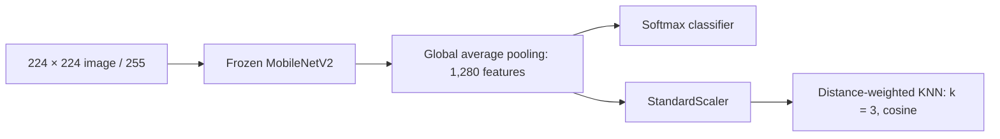

# Hybrid Vision Transfer Classifier

A mango leaf classification project comparing three approaches: a MobileNetV2 classifier, KNN on image pixels, and KNN on MobileNetV2 features. We built it for the Semester 1 Micro Credential Course in Artificial Intelligence and Robotics at Amrita Vishwa Vidyapeetham, Coimbatore.

The question was straightforward: how much does a useful image representation matter when the final classifier is a simple nearest-neighbour model?

## What the saved experiment shows

| Approach | Accuracy | MCC | Probability MSE | Probability MAE |
|---|---:|---:|---:|---:|
| MobileNetV2 + softmax | **99.12%** | 0.9900 | 0.0023 | 0.0079 |
| MobileNetV2 features + KNN | 98.25% | 0.9801 | 0.0032 | **0.0058** |
| Raw-pixel KNN | 68.12% | 0.6380 | 0.0523 | 0.0847 |

These values come from the existing [result reports](results/README.md), each with 800 test images. They have not been regenerated for this documentation update. The hybrid is much stronger than the raw-pixel baseline in the saved experiment, but the base neural classifier has the highest accuracy. The pure KNN script uses a different split procedure, so this is not a fully controlled comparison on an identical test set.


## Read the project

| Location | What it explains |
|---|---|
| [Project report](docs/project-report.md) | The experiment, implementation, results and limitations |
| [Run guide](codes/README.md) | Script roles, execution order and saved model files |
| [Reproducing and preserving results](docs/reproducing-results.md) | How to rerun in a separate checkout and keep the original evidence |
| [Dataset guide](DataSet/README.md) | Eight classes, image counts and label order |
| [Results](results/README.md) | Original PDF reports, confusion matrices and ROC curves |
| [Contributors](CONTRIBUTORS.md) | Team members and their recorded contributions |

## How the models work

**Base model.** Images are resized to 224 × 224 and divided by 255. An ImageNet-pretrained MobileNetV2 backbone stays frozen. Global average pooling produces 1,280 features, and a softmax layer is trained for 10 epochs.

**Hybrid.** The saved pooled feature extractor produces the same kind of 1,280-dimensional representation. A `StandardScaler` fitted on training features feeds a three-neighbour KNN classifier using cosine distance and distance-weighted voting. This is a feature-based pipeline, not knowledge distillation or joint CNN/KNN training.

**Pure KNN.** Images are resized to 100 × 100, flattened into 30,000 RGB values, standardised, and classified with three-neighbour KNN using its default distance and voting settings.



## Getting started

```bash
git clone https://github.com/Sudheeswar-Reddy/Hybrid-Vision-Transfer-Classifier.git
cd Hybrid-Vision-Transfer-Classifier
python -m venv .venv
```

Activate the environment with `.venv\Scripts\Activate.ps1` in PowerShell or `source .venv/bin/activate` on macOS/Linux, then install the existing dependency list:

```bash
python -m pip install -r requirments.txt
```

The filename really is `requirments.txt`. Its version ranges are not an environment lock; the historical package versions were not saved. TensorFlow installation and compatible package versions depend on your Python version and platform.

The repository includes **4,000 images: 500 in each of eight class folders**. You do not need to download a second copy to use the supplied dataset. The existing documentation attributes it to the [Mango Leaf Disease Dataset on Kaggle](https://www.kaggle.com/datasets/aryashah2k/mango-leaf-disease-dataset); consult the source for dataset terms and provenance.

Before training, follow the [separate-checkout workflow](docs/reproducing-results.md). In that checkout, run:

```bash
python "codes/BaseModel(CNN+MobileV2).py"
python "codes/KNN+BaseModel(CNN+MobileV2).py"
```

The base script must finish first. Close each plot window so execution can continue to the model-save step. The first run may download ImageNet weights. All images are loaded into memory, so allow for a substantial memory footprint.

The pure KNN script has a hardcoded Windows project path. It will not run from an arbitrary clone without recreating that expected path or changing the script. The original code is retained here; see the [run guide](codes/README.md) for the exact limitation.

## What a rerun saves

The base script writes `model/mango_basis_extractor.h5`; the hybrid writes `model/final_hybrid_model.pkl`. Repeating a run in the same checkout replaces those files. The base save contains the feature extractor, not the trained softmax classifier. Pure KNN does not save its fitted model.

The scripts print metrics and show plots; they do **not** automatically export the PNG/PDF files in `results/`. The existing nine artifacts are also preserved in [original-results.zip](results/reference/original-results.zip), with [checksums and source revision](results/reference/manifest.json). Trained weights from that historical run are not included.

## Scope and reproducibility

This is a student experiment on a labelled leaf-image dataset. It has not been validated as a field diagnostic system. Seeds are set to 42, but image enumeration is unsorted, dependency versions are open-ended, and hardware and TensorFlow operations may affect the outcome. Preserve a rerun as its own experiment rather than replacing the recorded numbers.

The source code, dataset, original result artifacts and [LICENCE](LICENCE) are unchanged. See the licence file for the project's non-commercial and commercial terms.
